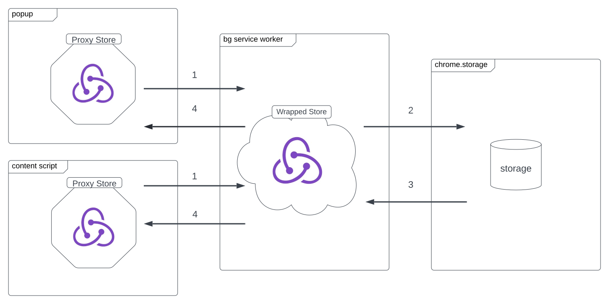

# State management

Redux Toolkit + a forked `webext-redux` for cross-context sync. All Redux
code lives in `src/state/`.

---

## Overview

We use [`@eduardoac-skimlinks/webext-redux`](https://github.com/eduardoacskimlinks/webext-redux),
a fork of `webext-redux` that supports Manifest V3 service workers (upstream
still assumes a persistent background page).

Topology:

- **Background service worker** holds the real store. It initialises
  `webext-redux`'s `wrapStore` wrapper via `initializeWrappedStore()`
  (defined in `src/state/webExtAdapter.ts`, re-exported from
  `src/state/index.ts`).
- **Popup** and **debug log page** each use the `proxyStore` from
  `src/pages/proxyStore.ts` (imported by `src/pages/popup/index.tsx` and
  `src/pages/debugLog/index.tsx`), which talks to the background store via
  `chrome.runtime` messages.
- The popup provides the proxy store through a normal React `<Provider>` so
  `useSelector` / `useDispatch` work the way components expect.



See [the webext-redux dataflow docs](https://github.com/tshaddix/webext-redux/wiki)
for the underlying mechanism.

---

## Location in the repo

```
src/state/
├── aliases.ts                        # UI → background thunk mappings
├── hooks.ts                          # typed useSelector/useDispatch/useDispatchAlias
├── index.ts                          # re-exports store + initializeWrappedStore
├── listenerMiddleware.ts             # generic listenerMiddleware entries
├── serverListListenerMiddleware.ts   # specialised listener for server list
├── store.ts                          # configureStore, reducers map, root reducer
├── webExtAdapter.ts                  # initializeWrappedStore (webext-redux wrapStore)
└── slices/
    ├── adPrivacyEnabled.ts
    ├── allowlist.ts
    ├── antiFingerprinting.ts
    ├── autopilot.ts
    ├── bestLocation.ts
    ├── blocker.ts
    ├── connection.ts
    ├── currentDataCenter.ts
    ├── currentLocation.ts
    ├── …                              # 56 slice files (55 wired into the store)
    └── workingApi.ts
```

> **Why 56 files, 55 wired?** `slices/proxyErrorChecking.ts` is **not a
> real slice** — the file header literally says so. It's an old
> `handleProxyError` thunk that was extracted into a standalone file to
> break a circular dependency with `slices/autopilot`, then later commented
> out wholesale once the live implementation was moved into
> `src/services/proxyConfig/proxyConfig.ts::handleProxyError`. The file is
> kept around as a reference for the historical reducer-side flow; it
> exports nothing and is intentionally not imported by `store.ts`.

All reducers are combined in `src/state/store.ts`:

```ts
const reducers = {
  adPrivacyEnabled: adPrivacyEnabledReducer,
  allowlist: allowlistReducer,
  // ...
  workingApi: workingApiReducer,
}
const combinedReducer = combineReducers(reducers)
```

---

## Root reducer — state-wide side effects

`store.ts` wraps `combinedReducer` in a `rootReducer` that intercepts two
global actions before delegating:

```ts
const rootReducer = (state, action) => {
  if (action.type === 'global/resetStore') {
    // keep ONLY these across a reset
    state = {
      userStashes: state?.userStashes,
      migrations: state?.migrations,
      permissions: state?.permissions,
    } as RootState
  } else if (action.type === 'global/applyUserStash') {
    state = { ...state, ...action.payload.toStash } as RootState
  }
  return combinedReducer(state, action)
}
```

- `global/resetStore` — used on logout. Wipes everything except user stashes,
  migration progress, and granted permissions.
- `global/applyUserStash` — restores a previously-saved user stash at
  login-time so people who logged out / back in get their privacy prefs,
  allowlist, favourites etc. back.

---

## Middleware

Five middleware are applied in `buildFrom()` (`src/state/store.ts`) — four
always on, one dev-only:

1. **`debugLogMiddleware`** — pipes every action into the in-app debug log,
   tagging by sender (`popup`, `debugLog`, or `background`). It keeps
   credentials out of the log; see [Debug log](#debug-log).
2. **`alias(aliases)`** — the `webext-redux` alias middleware. See next
   section.
3. **`listenerMiddleware.middleware`** — Redux Toolkit listeners used for
   generic side effects (e.g. `addListener` on state transitions).
4. **`serverListListenerMiddleware.middleware`** — a dedicated listener for
   server-list updates.
5. **`consoleLogger`** (dev only) — `redux-logger`. Pushed onto the
   middleware array only when `process.env.NODE_ENV === 'development'`.

Plus Redux Toolkit's default middleware (`getDefaultMiddleware()`), spread
in alongside the above.

---

## Aliases

For async work that must run in the **background** but is triggered from the
**popup**, you register an **alias**. When the popup dispatches
`{ type: 'alias/FOO', payload }`, `webext-redux` posts the action to the
background; the `alias()` middleware there swaps it out for the real thunk.

Without aliases, async thunks initiated in the popup run in the popup's
(ephemeral) context, which often can't reach the APIs it needs (e.g. no
access to the background's auth hash, or a fetch gets killed when the popup
closes).

Example — `src/state/aliases.ts`:

```ts
import { login, LOGIN } from './slices/session'

const _login: ActionCreator<Credentials, ReturnType<typeof login>> =
  ({ payload }) => login(payload)

export default {
  [`alias/${LOGIN_AUTH_TOKEN}`]: _getAuthToken,
  [`alias/${LOGIN}`]: _login,
  [`alias/${LOGOUT}`]: logout,
  [`alias/${FETCH_SERVER_LIST}`]: fetchServerList,
  [`alias/${FETCH_SERVER_CREDENTIALS}`]: fetchServerCredentials,
  [`alias/${FETCH_BEST_LOCATION}`]: fetchBestLocation,
  [`alias/${ADD_TO_ALLOWLIST}`]: _addToAllowlist,
  [`alias/${REMOVE_FROM_ALLOWLIST}`]: _removeFromAllowlist,
  [`alias/${FETCH_NOTIFICATIONS}`]: fetchNotifications,
  [`alias/${SAVE_USER_STASH}`]: saveUserStash,
  [`alias/${CHECK_USER_STASH}`]: checkUserStash,
  [`alias/${ACTIVATE_SPLIT_PERSONALITY}`]: activateSplitPersonality,
  [`alias/${TOGGLE_SPLIT_PERSONALITY}`]: toggleSplitPersonality,
  [`alias/${CHOOSE_ICON}`]: chooseIcon,
  [`alias/${CHECK_SESSION_STATUS}`]: checkSessionStatus,
  [`alias/${CHECK_CURRENT_IP}`]: checkCurrentIp,
}
```

Dispatch from a component with `useDispatchAlias` (from `src/state/hooks.ts`):

```tsx
import { useDispatchAlias } from 'state/hooks'
import { LOGIN } from 'state/slices/session'

const dispatchAlias = useDispatchAlias()
await dispatchAlias(LOGIN, { username, password, twoFa })
```

For aliases that need state access or multiple dispatches, use the thunk
form:

```ts
const example: ActionCreator<Payload, AsyncThunkAction> = originalAction => {
  return async (dispatch, getState) => {
    const hash = getState().session.sessionData?.session_auth_hash
    await dispatch(getEntityByParam(hash, originalAction.payload))
  }
}

export default {
  [`alias/${EXAMPLE}`]: example,
}
```

---

## Keeping the popup in sync

### Do

```tsx
import { useSelector, useDispatch } from 'state/hooks'
import { increment } from 'state/slices/example'

const Example = () => {
  const dispatch = useDispatch()
  const counter = useSelector(s => s?.example?.counter)

  const onClick = async () => {
    await dispatch(increment())
  }
  // ...
}
```

### Do not

```ts
// BAD — bypasses webext-redux, state won't round-trip to background
import store from 'state/store'
store.dispatch(increment())
```

All popup dispatches are **asynchronous** and return a Promise because the
proxy → background → proxy round trip goes through `chrome.runtime` messages.
Always `await`.

### Specific selectors

Selectors should be as narrow as possible — otherwise any unrelated change
to the same slice triggers a re-render:

```tsx
// good
const isPremium = useSelector(s => !!s.session.sessionData?.is_premium)

// bad
const session = useSelector(s => s.session)
const isPremium = !!session.sessionData?.is_premium
```

---

## Data compatibility between contexts

`webext-redux` uses Chrome's runtime messaging under the hood, which
serialises via the [structured clone algorithm](https://developer.mozilla.org/en-US/docs/Web/API/Web_Workers_API/Structured_clone_algorithm).
Non-cloneable values (functions, DOM nodes, class instances with prototype
chains) will either fail to send or be silently coerced.

Keep state **plain data**: booleans, numbers, strings, arrays of the same,
plain objects.

---

## Adding a new slice

1. Scaffold: `yarn slice` (runs `scripts/addSlice.mjs`). It creates the
   slice file and also adds the import and `reducers` entry to
   `src/state/store.ts`.
2. Edit the generated file in `src/state/slices/<name>.ts`:

   ```ts
   import { createSlice, PayloadAction } from '@reduxjs/toolkit'

   interface ExampleState { counter: number }
   const initialState: ExampleState = { counter: 42 }

   export const exampleSlice = createSlice({
     name: 'example',
     initialState,
     reducers: {
       incrementCounter(state) { state.counter += 1 },
       setCounter(state, action: PayloadAction<number>) {
         state.counter = action.payload
       },
     },
   })

   export const { incrementCounter, setCounter } = exampleSlice.actions
   export default exampleSlice.reducer
   ```

3. Check the edit `yarn slice` made to `src/state/store.ts`. It should
   look like this; don't add it again:

   ```ts
   import exampleReducer from './slices/example'

   const reducers = {
     // ...
     example: exampleReducer,
   }
   ```

4. If the slice needs async work that must run in the background, add an
   entry in `src/state/aliases.ts` and dispatch with `useDispatchAlias`.

5. If the slice's data must be migrated from MV2 storage, add an entry to
   `src/migrations/` and register it with the migration runner — see that
   folder.

---

## Routing

The popup is a single-page app but the extension uses a home-rolled
"navigation" service rather than React Router, because there's no URL bar to
drive it:

```tsx
import { useGoTo, useGoBack } from 'services/navigation'

const SplashPage = () => {
  const goToSignup = useGoTo('Signup')
  const goBack = useGoBack()
  return (
    <>
      <Button onClick={goToSignup}>Get started</Button>
      <Button onClick={goBack}>Back</Button>
    </>
  )
}
```

`view` in state (`src/state/slices/view.ts`) holds the active screen name;
`useGoTo` dispatches `setView`.

---

## Debug log

`src/services/debugLog/` stores a ring buffer of log items in IndexedDB
(Dexie). `debugLogMiddleware` pushes a log entry for every Redux action.
Some actions carry credentials, so the middleware does not log their payloads:

- The `session/login`, `AuthToken/login` and `servers/fetchServerCredentials`
  thunks, plus `serverCredentials/setServerCredentials`,
  `session/setSession` and `session/replaceSession`.
- The match covers the bare type, the `alias/` form, and the `/pending`,
  `/fulfilled` and `/rejected` actions of each thunk.
- Error details are kept: `errorCode`, `errorMessage`, `errorDescription`,
  `logStatus`, and the thrown `error` if there is one.
- `setSession`, `replaceSession` and a successful `session/login/fulfilled`
  log only these session fields: `username`, `user_id`, `email`,
  `email_status`, `reg_date`, `status`, `is_premium`, `billing_plan_id`,
  `premium_expiry_date`, `rebill`, `alc`, `traffic_used`, `traffic_max`,
  `last_reset`, `loc_hash`, `loc_rev`, `our_addr`, `our_dc`, `our_ip`,
  `our_location`. `session_auth_hash` and every other field are dropped.

The list lives in `SENSITIVE_ACTION_PREFIXES` and `SESSION_LOG_FIELDS` in
`src/state/store.ts`.

The debug log page (`src/pages/debugLog/`, a
separate `debugLog.html` opened in a tab from the context menu) reads the buffer and lets the user export it; the
`pruneLog` alarm trims old entries every 2 minutes.

---

## See also

- [`architecture.md`](./architecture.md) for how Redux fits into the overall
  extension topology.
- [`background-service-worker.md`](./background-service-worker.md) for how
  state is hydrated at service-worker startup.
- [`api.md`](./api.md) for how `sendRequest` (used by thunks) updates
  `state.workingApi` on failover.
